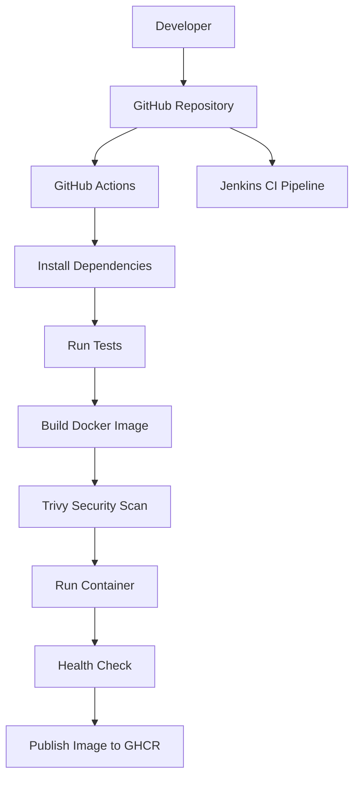

# CloudShip — CI/CD Automation & Container Security

CloudShip is a DevOps automation project that demonstrates how to test, containerize, scan, and publish a Node.js application using modern CI/CD tools.

The project integrates GitHub Actions, Jenkins, Docker, GitHub Container Registry (GHCR), and Trivy to create a repeatable application delivery workflow.

## Project Overview

CloudShip demonstrates the following DevOps practices:

- **Continuous Integration:** Install dependencies and run automated tests.
- **Containerization:** Package the application into a Docker image.
- **Container Security:** Scan Docker images for HIGH and CRITICAL vulnerabilities using Trivy.
- **Dependency Security:** Audit npm dependencies and review dependency changes in pull requests.
- **Continuous Delivery:** Publish Docker images to GitHub Container Registry.
- **Health Checks:** Verify that the application runs successfully inside a container.

## Architecture



## Technology Stack

| Technology | Purpose |
|---|---|
| Node.js | Application runtime |
| JavaScript | Application development |
| Git and GitHub | Source control |
| GitHub Actions | Automated CI/CD |
| Jenkins | Pipeline automation |
| Docker | Containerization |
| GitHub Container Registry | Container image storage |
| Trivy | Container vulnerability scanning |
| npm audit | Dependency security auditing |
| Node.js Test Runner | Automated testing |

## Application Endpoints

| Endpoint | Description |
|---|---|
| `/` | Returns the CloudShip service response |
| `/health` | Returns the application health status |
| Other routes | Return HTTP 404 |

Example health response:

```json
{
  "status": "ok",
  "service": "CloudShip"
}
```

## CI/CD Pipeline

The GitHub Actions workflow performs the following steps:

1. Checks out the repository.
2. Sets up Node.js 22.
3. Installs dependencies using `npm ci`.
4. Audits dependencies using `npm audit`.
5. Builds the Docker image.
6. Scans the image using Trivy.
7. Runs the container and verifies its health endpoint.
8. Publishes the image to GHCR when changes are pushed to `main` and all required checks pass.

The Jenkins pipeline checks out the repository, verifies the Node.js and npm versions, installs dependencies, and runs automated tests.

## Docker Image

**Container image:** `ghcr.io/jayasri-1805/cloudship`

Pull the image:

```bash
docker pull ghcr.io/jayasri-1805/cloudship:latest
```

Run the container:

```bash
docker run --rm -p 3000:3000 ghcr.io/jayasri-1805/cloudship:latest
```

Test the health endpoint:

```bash
curl http://localhost:3000/health
```

## Run Locally

**Prerequisites:** Node.js 22 or later and npm.

Clone the repository:

```bash
git clone https://github.com/jayasri-1805/CloudShip.git
cd CloudShip
```

Install dependencies:

```bash
npm ci
```

Run tests:

```bash
npm test
```

Start the application:

```bash
npm start
```

Open `http://localhost:3000/health` in your browser.

## Security Practices

- npm dependency vulnerability auditing.
- Trivy image scanning with a HIGH and CRITICAL severity gate.
- `.gitignore` rules to help prevent committing secrets and dependencies.
- `.dockerignore` rules to exclude unnecessary build-context files.
- Non-root execution of the application container.
- Pull-request dependency review.

Security scans help identify known vulnerabilities but do not guarantee that an application is completely secure.

## Project Structure

```text
CloudShip/
├── .github/
│   └── workflows/
│       ├── docker-build.yml
│       └── dependency-review.yml
├── src/
│   └── server.js
├── test/
│   └── server.test.js
├── .dockerignore
├── .gitignore
├── Dockerfile
├── Jenkinsfile
├── package.json
├── package-lock.json
├── README.md
└── architecture.mmd
```

## Future Enhancements

- Deploy the container using a verified free-tier cloud service.
- Add deployment verification and rollback strategies.
- Introduce structured logging and application metrics.
- Improve release versioning and image provenance.

**Cost awareness:** Cloud deployment is optional. Verify current pricing and resource limits before provisioning cloud services.

## Links

- **GitHub Repository:** https://github.com/jayasri-1805/CloudShip
- **Container Package:** https://github.com/jayasri-1805/CloudShip/pkgs/container/cloudship
